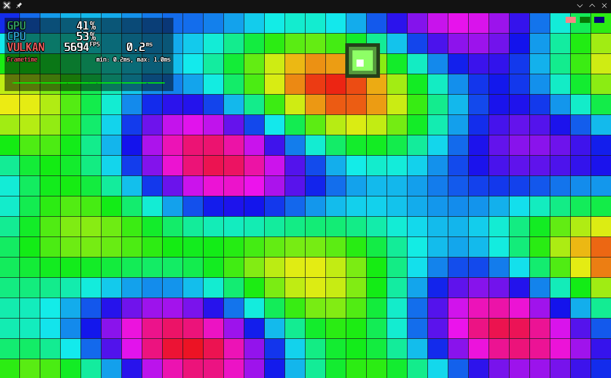
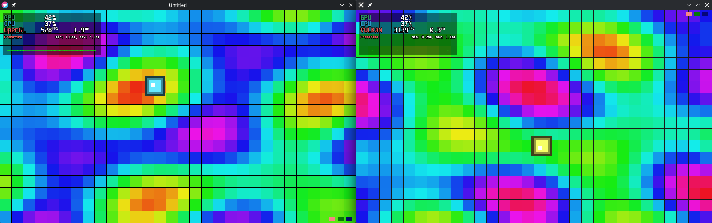

# lupa

An incredibly fast, pure LuaJIT game creation framework.



## How does it compare to Love2D?

This is very experimental, so it's not ready to replace your love2d usage, not yet.



Functionally identical code running on both results in 5x faster speeds on lupa compared to love2d.

## How is it so fast?

Sorted by impact

1. LuaJIT is used throughout the entire process. No Lua C Api overhead.
2. It is written from scratch, so everything can be scrutinized and optimized.
3. Vulkan is used.

## Drawing

Everything goes through the `draw` object your app is handed in `draw(self, draw)`.

### 2D

```lua
draw:setColor(1, 0.5, 0.2, 1)   -- r, g, b, a (alpha optional, defaults to 1)
draw:rect(x, y, w, h)
```

The default view is orthographic with `y = 0` at the **bottom** of the window,
and the frame starts from a clear colour of `0.1` grey. Set your own with
`draw:setClearColor(r, g, b)` -- a sky, or the backdrop of a 2D scene.

### 3D

```lua
draw:setCamera({
    position = { x = 0, y = 6, z = 18 },
    target   = { x = 0, y = 0, z = 0 },
    up       = { x = 0, y = 1, z = 0 },   -- optional, this is the default
    fov      = math.pi / 3,               -- optional, radians
    near     = 0.1,                       -- optional
    far      = 1000,                      -- optional
})

draw:setLighting({                        -- optional; unlit by default
    ambient = { 0.16, 0.19, 0.28 },       -- the floor the world is lit by
    lights  = {
        { dir = { x = -0.4, y = -1, z = -0.3 }, color = { 1, 0.95, 0.88 } },
        { pos = { x = 3, y = 2, z = 0 }, radius = 12, color = { 1, 0.6, 0.2 } },
    },
})

draw:setColor(0.9, 0.5, 0.2, 1)
draw:cube(x, y, z, size)
draw:sphere(x, y, z, radius [, segments])
draw:plane(x, y, z, width, depth)         -- horizontal, facing +Y

draw:clearLighting()
draw:setOrtho()                           -- back to the 2D view
```

A light carrying a `dir` shines the same way everywhere, like a sun; one carrying a
`pos` and a `radius` sits at a place and reaches as far as the radius. Up to
`limits.lights` (8) of them light a frame. The table is read rather than kept, so
one can be built once and changed in place between frames:

```lua
lighting.lights[1].color = { 0.2, 0.2, 0.3 }
draw:setLighting(lighting)
```

Primitives batch into the same draw call as 2D rects, so a scene is one
`vkCmdDrawIndexed` no matter how many objects it holds.

#### Model transforms

```lua
draw:pushModel()
draw:translate(x, y, z)
draw:rotate(angle, axisX, axisY, axisZ)   -- axis defaults to +Y
draw:scale(s)                             -- or (sx, sy, sz)
draw:cube(0, 0, 0, 1)
draw:popModel()

draw:resetModel()                         -- clear the whole stack
```

The transform is applied on the CPU as vertices are written, in this order:

```
world = model * (localVertex * scale) + primitivePosition
```

so the position argument is **not** rotated -- `rotate(...)` then `cube(5, 0, 0, 1)`
spins the cube in place rather than orbiting it. Put the position inside the
transform (`translate(5, 0, 0)` then `cube(0, 0, 0, 1)`) if you want it to orbit.

### Shadows

A light casts shadows when `shadows` is set on it. The scene is drawn from the light
into a map of packed depth, which the main pass samples:

```lua
draw:setLighting({
    lights = {
        { dir = { x = -0.4, y = -1, z = -0.3 }, shadows = true },
        -- or, to tune it:
        { dir = { x = -0.4, y = -1, z = -0.3 },
          shadows = { distance = 96, cascades = 4, filter = 2 } },
    },
})
```

#### Cascades

One map over a view that reaches a long way is either blocky or short-sighted: the
same texels have to cover the ground at arm's length and the hills on the horizon.
So the map is a *cascade* of them. The view is cut into slices, each slice is drawn
into its own map through a box fitted to it, and a fragment is shadowed by the map of
the slice it is in:

```lua
shadows = { distance = 96, cascades = 4 }
```

| | |
| --- | --- |
| `distance` | how far shadows reach, in world units; past it a surface is lit |
| `cascades` | how many maps that is split into, 1 to `limits.shadowCascades` (4) |
| `split` | 0 to 1, how much the splits favour the near view over an even split |
| `blend` | share of each cascade's range blended into the next, to hide the join |
| `filter` | width of the shadow filter, in texels; higher is softer |
| `bias` | depth offset that keeps a surface from shadowing itself |
| `normalBias` | shadow texels a sample is pushed along its own normal |

The splits default to a blend of an even split and a logarithmic one, so the nearest
cascade covers a few units and the last one covers `distance`. A map is 1024 texels
square (`limits.shadowSize`), so four cascades over 128 units put four times the
texels on a block at arm's length that one map over the same distance would. Two
things make the texels stay where they are: each box is fitted around the *bounding
sphere* of its slice, which is the same size however the camera is turned, and its
centre is moved to the nearest whole texel. A map whose texels keep still does not
crawl when the camera moves.

The filter is nine taps in a square around the sample, weighted so the middle counts
for most of it. Nine is where a hard edge of a staircase becomes a line without the
noise a rotated pattern puts on a flat surface.

#### The far end of the view

```lua
draw:setLighting({
    ambient = { 0.25, 0.25, 0.3 },
    lights  = { { dir = sun } },
    fog     = { color = sky, near = 300, far = 420 },
})
```

`fog` fades what is drawn into `color` between `near` and `far`, squared so the fade
is gentle at first, and is what keeps a view that ends at a distance from ending in a
line. `far = 0` is no fade at all, and `near` defaults to a third of `far`.

#### Cost, and what casts

The cost is one pass over the frame's geometry *per cascade*, with a vertex shader
that only transforms. A scene that draws a view of a hundred chunks can say which of
them each cascade reaches, by drawing its casters nearest first and naming how many
of them each one draws:

```lua
draw:setLighting({ lights = { { dir = sun, shadows = { distance = 128 } } } })

for index, chunk in ipairs(casters) do      -- nearest first
    draw:mesh(chunk.mesh, chunk.x, 0, chunk.z)
end
draw:endShadowCasters({ 9, 25, 60, 121 })   -- what each cascade draws
```

`draw.shadowSplits` says how far each cascade reaches, and is there as soon as the
lighting is set, so the counts can be worked out while the casters are drawn. Records
drawn after the call are still in the frame, they are just not in any map. A point
light never casts, because that would be six maps per cascade.

`clearLighting()` turns the shadows off with the lights, and `tools/shadowprobe.lua`
measures what a change to any of this did to a scene: acne on a lit surface, how wide
the fade at the edge of a shadow is, and whether an occluder 60 units away casts at
all.

### A HUD over the 3D view

A frame draws one projection, so a 3D scene and a 2D HUD need two. Drawing state,
the transform block and the lighting are all per frame, and `beginOverlay()`
starts a second pass that has its own of each: screen space in the 2D view, unlit,
and drawn on top of whatever the camera left, without testing depth against it.

```lua
draw:setCamera({ position = { 0, 4, 12 }, target = { 0, 0, 0 } })
draw:setLighting({ lights = { { dir = { 0, -1, 0 }, shadows = true } } })
draw:cube(0, 1, 0, 2)                       -- 3D, lit, shadowed

draw:beginOverlay()
draw:setColor(1, 1, 1, 1)
draw:rect(10, 10, 40, 8)                    -- a HUD bar in screen pixels
```

Everything drawn before `beginOverlay()` makes up the scene, including the shadow
pass; everything after it is the overlay. `draw:instanceCount` and
`draw:drawRecordCount` cover the whole frame, `draw.sceneRecords` how much of it
is the scene.

### Meshes that carry their own tiles

A mesh built with a stride of 9 puts a texture tile at the end of every vertex -- the
index of a tile in the array, or -1 to sample whatever `setTexture` selected. The uv
of such a vertex is how many tiles across the face is, so a face that spans several
blocks repeats its tile instead of stretching it, and one mesh can hold every kind of
block a chunk is made of.

```lua
-- x, y, z, nx, ny, nz, u, v, tile
assets:mesh({
    0, 0, 0, 0, 1, 0, 0, 1, 3,
    4, 0, 0, 0, 1, 0, 4, 1, 3,   -- four tiles across
    4, 0, 4, 0, 1, 0, 4, 0, 3,
    0, 0, 4, 0, 1, 0, 0, 0, 3,
}, { 0, 1, 2, 0, 2, 3 }, 9)
```

Every sample of a wrapped tile is kept half a texel inside its image, because the
texel next to an image belongs to the layer and holds nothing: without that, the join
between two blocks of one face lets the background through.

#### What a vertex costs

A mesh is handed in as floats and stored as **16 bytes**: a position in 16 bits of the
mesh's own size, the normal in three signed normalized bytes with the tile in the
fourth, and a uv in 16 bits of the mesh's own range. What those integers are worth
travels with the instance that draws the mesh, so it is the size of the mesh that
decides, and a mesh keeps detail down to about a 32767th of itself however big it is:

| mesh | one stored position unit |
| --- | --- |
| a 16 unit chunk | 0.5 mm |
| a 4 unit car | 0.12 mm |
| a 1000 unit level | 3 cm |

The scale is computed once, when the mesh is uploaded, and a rebuilt mesh measures
itself again. The upshot is that a whole view of the world costs about 4800 vertices
and 42 KB a chunk, and a car model costs a third of what it did.

### Textures

Setting a texture is state; drawing is separate. There is no `draw:image`:

```lua
local tex = assets:image("assets/player.png")   -- PNG, cached by path

draw:setTexture(tex)
draw:rect(x, y, tex.width, tex.height)           -- one quad, whole texture
draw:cube(x, y, z, size)                         -- or any 3D primitive
draw:clearTexture()                              -- back to flat colour
```

Images are read and written with `lupa.png`, which handles 8 bit greyscale, RGB and RGBA
PNGs and refuses anything else rather than guessing:

```lua
local width, height, pixels = png.decode(data)   -- rgba8, a row at a time from the top
local data = png.encode(width, height, pixels)   -- 8 bit RGBA, no interlacing
```

Reading a file and handing its bytes back is the caller's business, which is what
`assets:image` does with `png.decode`.

`draw:setTextureRect` picks which part of the texture maps onto each shape. It is
**per draw call**, so a sprite sheet can be sliced into as many cells as you like
in one frame:

```lua
draw:setTexture(sheet)

draw:setTextureRect(0.25, 0, 0.5, 0.5)           -- one cell
draw:rect(x, y, 64, 64)

draw:setTextureRect(0, 0, 8, 4)                  -- tile 8 by 4
draw:rect(x, y, 256, 128)
```

`draw:setColor` tints, as it does for untextured shapes. Images live in a single
texture array, so textured and untextured geometry still batches into one draw
call. A PNG larger than `MAX_TEXTURE_WIDTH` x `MAX_TEXTURE_HEIGHT` is
box-filtered down to fit.

Every texture is given the smaller levels a sampler reads when an image covers fewer
pixels than it has texels (`limits.textureMips`, four of them), and they are filtered
row by row when `rows` says an image is a stack of tiles:

```lua
local tex = assets:texture(w, h, pixels, {
    rows     = 3,      -- three tiles stacked, filtered one tile at a time
    emission = 0.4,    -- that much of the texture's own colour added to what lights it
    cutout   = true,   -- texels under half an alpha are not drawn at all
})
```

`emission` is what makes a texture glow in the dark without anything lighting it, and
`cutout` is what makes it possible to have holes in a block: a leaf is drawn with the
opaque geometry with its gaps discarded, so what is behind it shows through. `rows`
matters because filtering across the join between two tiles would make a distant block
average towards the colour of all its faces at once, which reads as the world changing
colour with distance.

### Meshes

Meshes are resources, so they are built through `assets` alongside textures,
and drawn through `draw`:

```lua
local mesh = assets:obj("assets/torus.obj")      -- Wavefront .obj, cached

-- or build one directly: 8 floats per vertex -- x, y, z, nx, ny, nz, u, v --
-- followed by 0-based triangle indices
local tri = assets:mesh({
    0, 0, 0,  0, 0, 1,  0, 0,
    1, 0, 0,  0, 0, 1,  1, 0,
    0, 1, 0,  0, 0, 1,  0, 1,
}, { 0, 1, 2 })

draw:setTexture(tex)
draw:pushModel()
draw:translate(x, y, z)
draw:rotate(angle, 0, 1, 0)
draw:mesh(mesh, 0, 0, 0, scale)
draw:popModel()
```

Meshes take vertex colours, the current texture and the model matrix exactly like
the built-in primitives, and batch into the same draw call.

A mesh that changes -- a chunk of a voxel world, a procedurally built shape -- is
rebuilt in place with `mesh:update(vertices, indices)`. It keeps its place in the
arena while the new geometry fits there, and the next frame draws it:

```lua
mesh:update({ ...8 floats per vertex... }, { 0, 1, 2 })
```

A type that is no longer drawn should be updated with an empty table rather than
dropped, so it stops being drawn without leaving its space in the arena behind.

A mesh the game is finished with -- a chunk that has been unloaded, a level that
has been left -- hands its room back with `draw:releaseMesh(mesh)`, and the next
mesh placed takes that room instead of growing the arena. Without the call the
room stays reserved, because a draw cannot know whether a mesh will come back:

```lua
draw:releaseMesh(mesh)  -- drawn again later, it is uploaded afresh
```

A game that knows how much geometry it is going to draw can hold the room up front
with `draw:reserveMeshSpace(vertexBytes, indexBytes)`. Growing an arena re-uploads
every mesh already in it, so reserving before anything is placed is what keeps a
world that streams in from hitching when it turns around:

```lua
draw:reserveMeshSpace(64 * 1024 * 1024, 16 * 1024 * 1024)
```

The `.obj` loader handles positions, UVs, normals and n-gon faces (fan
triangulated). Files without normals get flat per-triangle normals so lighting
still works.

### Limits worth knowing

- **One projection and one shader per frame.** There is a single `viewProj`
  uniform, so a frame is drawn either with the 2D ortho or with a camera, not
  both. Mixing a 3D world with a 2D HUD needs per-batch state.
- **Textures are a fixed array** of `MAX_TEXTURES` layers, each
  `MAX_TEXTURE_WIDTH` x `MAX_TEXTURE_HEIGHT`, allocated up front.
- **The mesh arenas grow, and never shrink.** A mesh that is released leaves room
  behind for the next one, so a world that streams in and out settles at a size
  rather than growing forever, but the room is only given up when the arena is
  full.
- **Mesh uploads cost one submission per frame**, not one per mesh: everything
  written before a frame is recorded goes to the GPU in one batch. A game that
  rebuilds a thousand meshes in a frame pays for one of them.
- **Shadows are one light deep.** One map is rendered per cascade per frame, from
  the first light that asks for it, so a second light asking is lit by the map of the
  first rather than one of its own -- and a point light never casts.
- Loads and texture levels are built on the CPU: a texture gets four levels, box
  filtered when it is added, and there is no blit to make more.

## Input

```lua
if input:isHeld("w") then                      -- held down this frame
if input:wasPressed("escape") then             -- went down this frame
if input:wasReleased("space") then             -- came up this frame
if input:modifiers().ctrl then                 -- a modifier another key was pressed with

local x, y = input:mousePosition()
local dx, dy = input:mouseMotion()
if input:isMouseHeld("left") then
input:setCursorGrab("locked")                  -- "locked", "contain" or "none"
```

A modifier name covers either key that carries it, so `isHeld("ctrl")` is either
control key and `isHeld("left-ctrl")` is only the left one. A modifier that is held
on its own is a key like any other, and one that is held while another key is pressed
and released is reported by `input:modifiers()`, which is what a game that sprints on
`Ctrl` wants.

## Time

`lupa.now()` is seconds from the monotonic clock, and the `dt` a frame is given comes
from it, clamped to a tenth of a second so a stall does not move the world on without
the game seeing it:

```lua
function App:update(dt, input)
    self.time = self.time + dt * speed        -- seconds, not frames
end
```

`os.clock()` is the processor time the whole process has burned, driver threads
included, so it runs ahead of the wall clock on a frame that waits on the GPU; use
`lupa.now()` for anything a player would see move.

## Tests

`lde test` runs the suite in `tests/`. Rendering runs headless: a frame is drawn
into an offscreen target and read back, so the drawing API is checked by pixels
rather than by eye.

## Style

`STYLE.md` is the guide this code is written to: full LuaCATS typing, cached FFI
types, and comments only where they record an invariant that would otherwise look
like a mistake.

## Usage

Set up [lde](https://lde.sh).

```
lde add lupa --git https://github.com/bycruz/lupa
```
